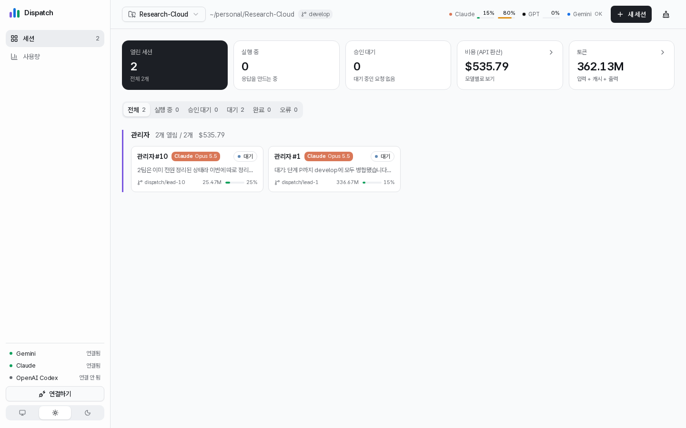
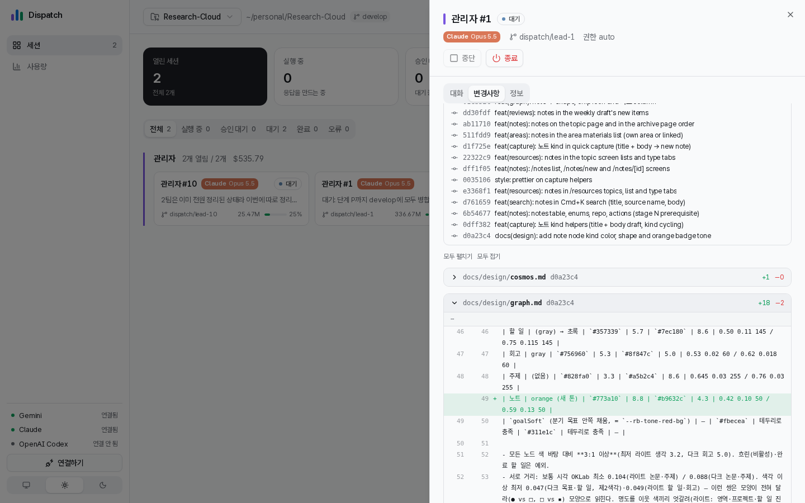
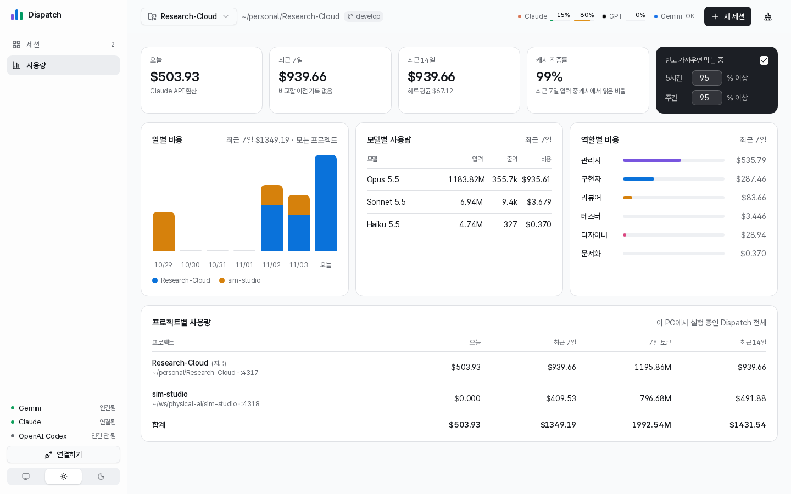
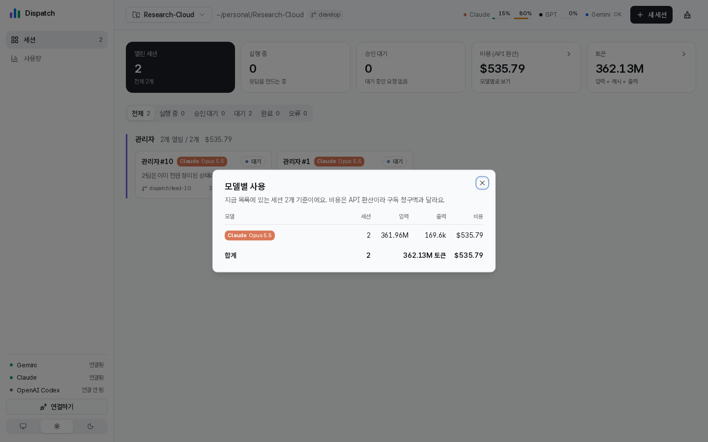
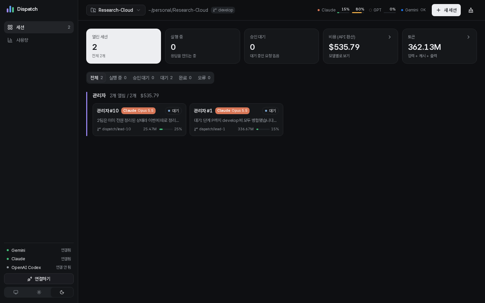

# Dispatch

Local web UI for running several role-based Claude Code, Codex and Gemini sessions side by side in one project.



- Pick roles (관리자, 구현자, 리뷰어, 테스터, 디자이너, 문서화) and, per role, a model, effort, permission mode and how many sessions.
- Each session works in its own git worktree (`.dispatch/wt/<role>-<n>`, branch `dispatch/<role>-<n>`), so parallel sessions never overwrite each other.
- 관리자 sessions get a Dispatch MCP server and can create, message and stop other sessions; teammates report back to their lead automatically.
- Live transcript with a CLI-style thinking line (`✻ Untangling… (1m 5s · ↓ 12.3k tokens)`), collapsible tool calls, and coloured `+`/`-` lines for diffs and `git --stat`.
- Sessions get short names (Juno, Cal, Sam …); the role shows beside the name and in every report.
- Long-lived sessions stay cheap: after 5 turns for a lead and 10 for other roles, a session continues in a fresh CLI session with a handoff note (its last answer and, for a lead, its teammates), so the context does not keep growing. Change the counts on the **설정** page (`0` turns it off).
- Teams are tuned for speed and tokens: the lead runs on Sonnet, each implementer takes one task, a review without must-fixes merges at once, and finished sessions are removed as the team goes. New worktrees get `node_modules` as hard links, so nobody waits on an install.
- Sessions and board tasks that look stuck are flagged with a plain reason: the same test, build or lint command failing 3 times in a row ("e2e가 3번 연속 실패했어요"), 10 minutes with no output, a stage past 1.5× its eta, or the board saying 구현 while the owner keeps running tests. A command whose exit code hides the result (`npm test | tail`, `|| true`) isn't counted; the same command in another directory counts separately. Only a hash of the command and the counts are kept. Tune or turn off each check with the `stuck*` team settings (`POST /api/settings`, `0` = off).
- Every session answers in a short, action-first style (the `i-have-adhd` rules when that Claude Code plugin is installed; turn it off on the 설정 page).
- Works as a skill in both Claude Code and Codex.

| | |
|---|---|
|  **변경사항** — everything the session's branch changed since it left your branch (commits + uncommitted edits), per file with line numbers. |  **사용량** — daily cost stacked by project, per-model and per-role totals, and every Dispatch project running on this machine. |
|  Click **비용** or **토큰** for a per-model breakdown. |  System / light / dark / 모니터링 theme, shared by every project. |

### At a glance

- **확인 필요** (top of 세션): one row per thing that needs you — a session waiting on your answer or a permission, a stuck or failed session, a task past its estimate or whose board stage disagrees with what its owner is doing, a task whose merge check failed, a Claude limit at 75 % or more (red once it reaches the usage-limit guard set in 설정). Each row says why and for how long, and opens the session (or 사용량). Empty, it folds to "지금 볼 것 없어요". Open sessions, cost and tokens sit in one small line under it; click cost or tokens for the per-model breakdown.
- **Session cards** are ordered by what needs you: 실패, 사람 기다림, 멈춤, 작업 중, 쉼, 완료 — the longest-standing first within a state — and each shows how long it has been in that state ("12분째"). Cards move only when a state changes. Finished sessions are hidden under **완료 N개 보기** at the bottom; a failed session is never hidden and stays in 확인 필요.
- **상시 화면 (TV):** the top-bar **상시 화면** button (or `#tv` in the address bar) opens a dark, always-on view: a big state grid and the "확인 필요" area, no scrolling. Every state shows a shape, a colour and a label. `Esc` closes it.
- **Session sheet:** runs of tool calls fold into one counted line; open it for the raw input and output.
- **Top bar:** usage limits per provider — Claude 5-hour and weekly, GPT (Codex) windows, and Gemini's state (Gemini reports no percentage, so it shows OK until a quota error, then the reset time). Hover for reset times.
- **프로젝트 선택:** switch between the Dispatch servers running on this machine (one per project).
- **새 세션** starts sessions. **끝난 세션 정리** removes finished sessions in one click; the broom icon stops and removes every session of this project after a confirmation. Branches stay; a worktree goes with its session only when nothing uncommitted is left.
- **작업** opens the lead's task board: stage, owner, time left or how late ("12분 지연"), and what each owner is doing right now ("Remy · e2e 실행 · 4분째", amber when it has run long).
- **설정** (bottom left): per-project team settings — when sessions continue fresh, teammates per lead, default model per role, worktree handling, reply style and the usage-limit guard.
- **사용량** also shows what the project is spending right now (**지금 시간당**, $/h over the last 30 minutes, falling back to 0 while sessions sit idle), the ten sessions that cost the most with a warning when one spends 3× the team's rate or has run 3 hours on a large context (for a lead: start a fresh one), and a marker on days that cost 2× the usual, naming the sessions behind them.
- **사용량 → 한도 가까우면 막기** blocks new Claude sessions above the thresholds you set. When a threshold is reached, every lead's unfinished board tasks (and its last note and team) are saved as a **ticket**; after the reset the ticket is handed back to the lead automatically, or resume it yourself from the 작업 dialog.

Requires Node.js 22.6+ (Node 20 is end-of-life; `npm test` loads TypeScript files directly, which needs 22.6), git, and at least one of the `claude`, `codex` or `agy` (Antigravity, for Gemini) CLIs.

## Install as a Claude Code plugin

```
/plugin marketplace add chanyee725/Dispatch
/plugin install dispatch@dispatch
```

On Claude Code 2.1.275 or later this is one step: `/plugin install dispatch --marketplace chanyee725/Dispatch`. The plugin brings the `dispatch`, `dispatch-team` and `dispatch-update` skills and the server; update it with `/plugin marketplace update dispatch` then `/plugin update dispatch@dispatch` (restart running Dispatch servers afterwards, or ask "디스패치 업데이트"). Codex users and anyone who wants a git clone: use the setup below.

## Set up (once per machine)

```bash
git clone https://github.com/chanyee725/Dispatch ~/tools/Dispatch
~/tools/Dispatch/scripts/setup.sh
```

`setup.sh` checks the tools, links the skill into `~/.claude/skills` and `~/.codex/skills`, and asks which CLIs to log in. Options:

| Option | Effect |
|---|---|
| `--project <dir>` | Also link the skill into that project (`.claude/skills`, `.agents/skills`). Repeatable. |
| `--login claude,codex` | Log in without asking (`claude`, `codex`, `both`, `none`). |
| `--no-global` | Skip the links in your home directory. |

Re-run it any time; links are refreshed and logged-in CLIs are skipped. To bring a machine up to the latest commit later, run `~/tools/Dispatch/scripts/update.sh` (or ask Claude Code / Codex "디스패치 업데이트"): it pulls, relinks every skill and restarts all running Dispatch servers on their ports. On Windows use `powershell -ExecutionPolicy Bypass -File scripts\update.ps1` (skills are linked as junctions, no admin rights needed). The skill links point at this clone, so `git pull` here updates every project.

## Use in a project

From inside the project, ask Claude Code or Codex: **"dispatch 띄워줘"**. Or run it yourself:

```bash
~/tools/Dispatch/skills/dispatch/scripts/start.sh "$PWD"    # → http://127.0.0.1:4317
~/tools/Dispatch/skills/dispatch/scripts/stop.sh "$PWD"
```

1. On the first screen, connect Claude, Codex and/or Gemini. Dispatch starts with both disconnected even when the CLIs are logged in; connecting reuses the CLI login, or opens the CLI's browser login if there is none. Disconnecting in Dispatch leaves the CLI login alone.
2. **새 세션** → write the shared prompt, add roles, pick model / effort / permission / count → start.
3. Click a session card for its transcript, permission requests, diff and token details.

Notes:

- The project needs at least one commit for worktrees; without one, sessions run in the project folder.
- `.dispatch/` (worktrees, state, logs) is added to the project's `.git/info/exclude`; its `.gitignore` is untouched.
- One server per project. Run another project at the same time with `DISPATCH_PORT=4318 …/start.sh <dir>`; the port is remembered in `.dispatch/server.port`, so `restart.sh` reuses it.

### Sharing with a team

Add Dispatch as a submodule and link the skill so everyone who clones the project gets it:

```bash
git submodule add https://github.com/chanyee725/Dispatch tools/dispatch
mkdir -p .claude/skills .agents/skills
ln -s ../../tools/dispatch/skills/dispatch .claude/skills/dispatch
ln -s ../../tools/dispatch/skills/dispatch .agents/skills/dispatch
```

## Develop

```bash
npm run dev                 # server (:4317) + Vite live-reload UI (:5173) in one terminal; Ctrl+C stops both
npm run dev -- ../other     # same, against another project
npm run dev -- --no-web     # server only, serving the last build
npm run build               # builds web/ into public/
```

`npm run dev` installs `web/` dependencies on first run. Ports: `DISPATCH_PORT`, `WEB_PORT`. The HTTP API is documented in [skills/dispatch/reference/api.md](skills/dispatch/reference/api.md); contributor notes for agents are in [AGENTS.md](AGENTS.md). What changed in each version: [CHANGELOG.md](CHANGELOG.md) and [Releases](https://github.com/chanyee725/Dispatch/releases).

## Privacy

The server has no npm dependencies and binds to 127.0.0.1 only. Per project it keeps session metadata and usage totals in `<project>/.dispatch/state.json` and transcripts in `<project>/.dispatch/transcripts/`. UI preferences (the theme) live in `~/.dispatch/prefs.json`, and running servers register in `~/.dispatch/servers/`. For the GPT limit gauge it reads only the `rate_limits` numbers from Codex's newest local session log. Tokens, API keys and account emails never pass through Dispatch.
